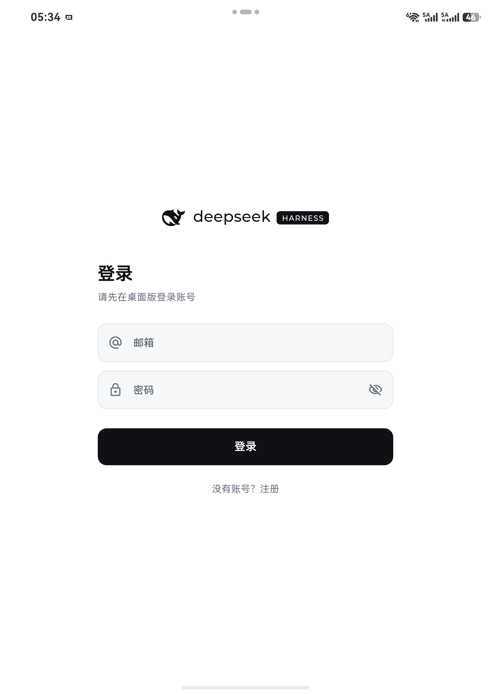
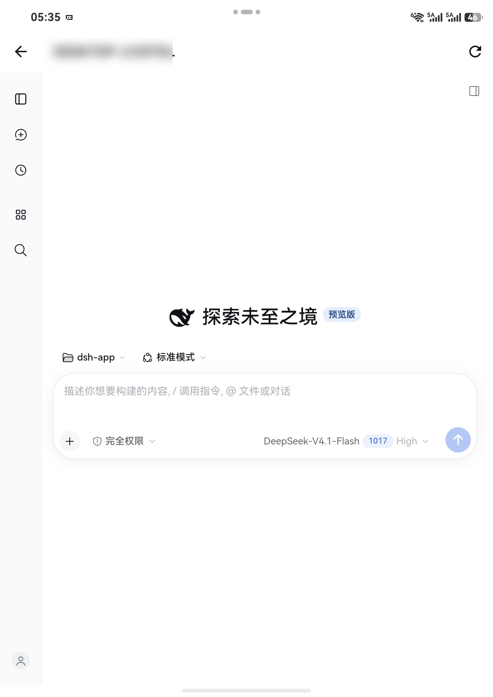
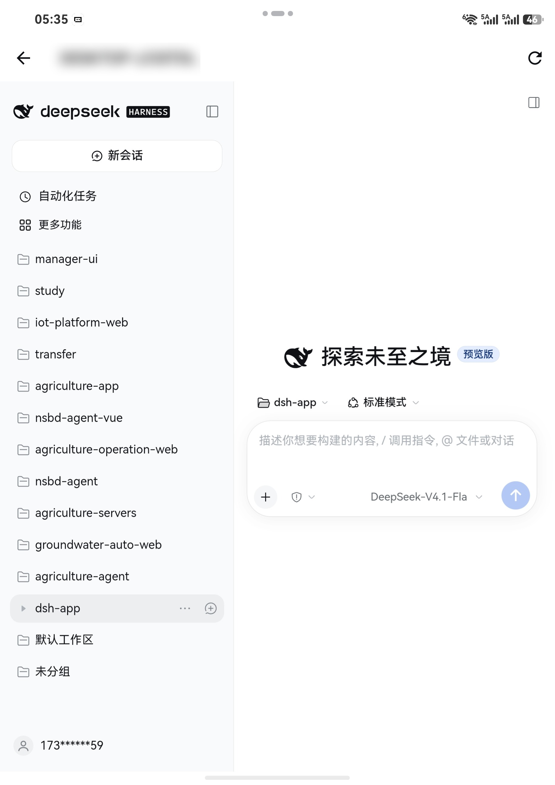
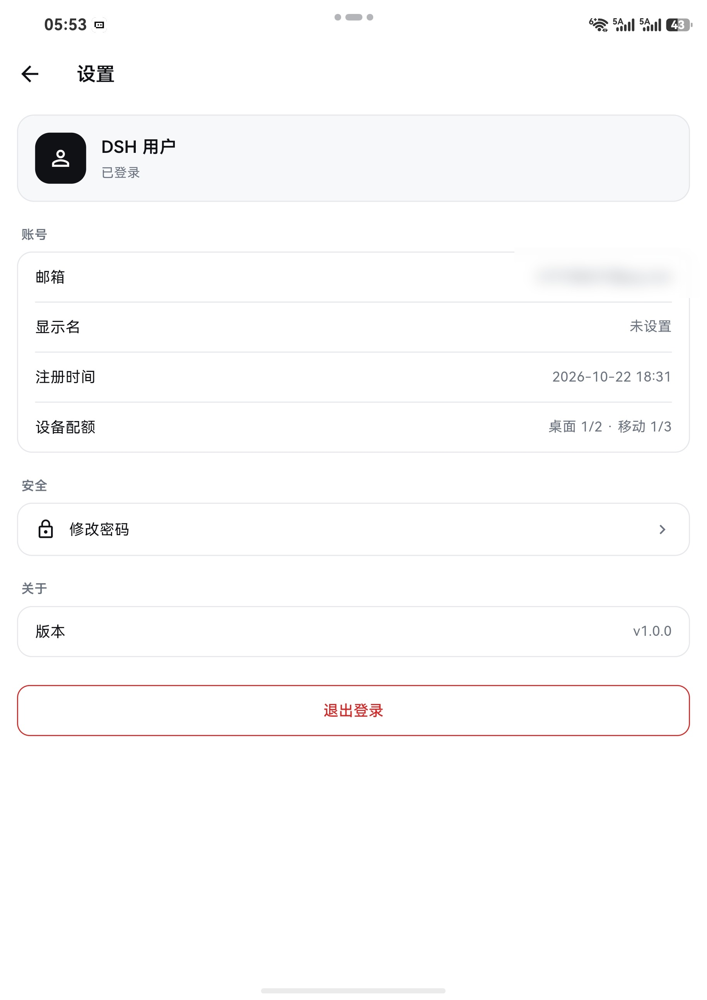
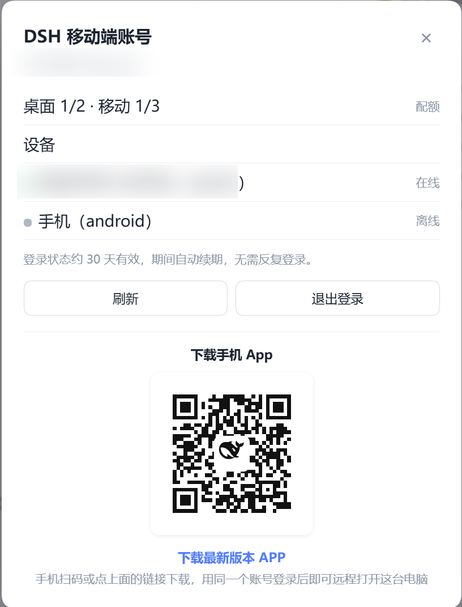
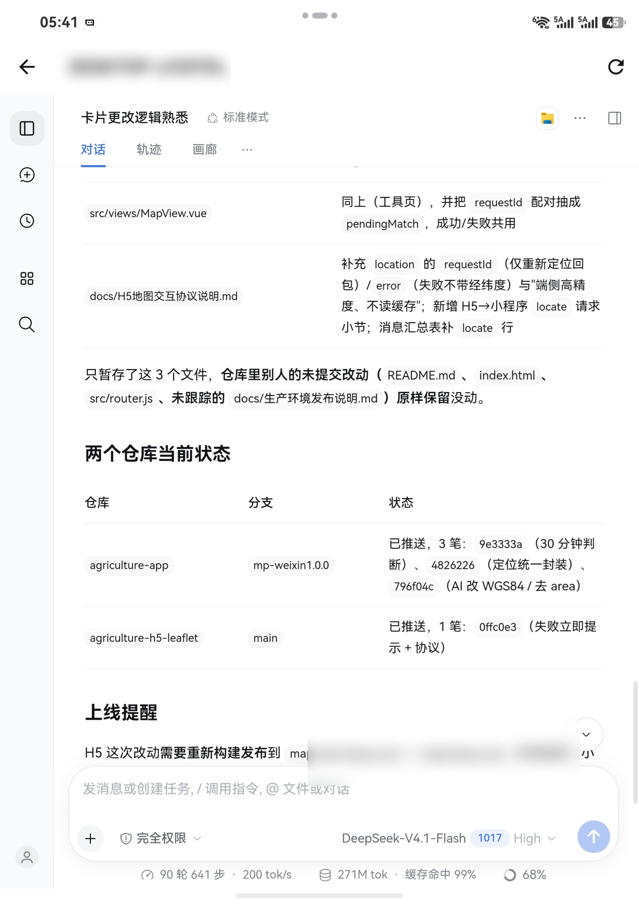

# dsh-app · DeepSeek Harness 移动端远程控制

手机通过自建中继服务器，远程使用电脑上的 DeepSeek Harness：
无需公网端口、无需 Tailscale，电脑出站建隧道，手机走 HTTPS。

## 架构

```
手机 App（Flutter）
  │ HTTPS + Cookie
  ▼
中继服务 dsh-account（Fastify + PostgreSQL）
  │ /t/:deviceId/* 反向代理
  │ 隧道 WSS（register/registered/req/res/wsopen/wsdata/wsclose/ping）
  ▼
桌面插件 dsh-mobile-tunnel（DSH Cordis 插件）
  ├─ 用一次性令牌换 DSH 认证 Cookie
  └─ 转发到 DSH Web UI（127.0.0.1:随机端口）
```

- 路径白名单：`/`、`/api/*`、`/assets/*`、`/plugins/*`、`/dsh-whale/*`、`/dsh-market/*`、`/open-in-app/*`、`/bsk-observation/*`、`/mcp-connector/*`、`/favicon*`、`/manifest*`
- 隧道消息**保留 binary 标记**，WebSocket 帧双向转发
- 移动端短边 `< 600dp` 自动挂载适配层；WebView 内注入 `data-dsh-mobile-app`

## 目录

| 目录 | 内容 |
|---|---|
| `server/` | 中继服务：账号 / 设备 / 会话 / 隧道 / HTTP+WS 代理 |
| `dsh-mobile-tunnel/` | 桌面插件 `dsh-mobile-tunnel`：出站隧道、Cookie、账号面板、客户端移动端增强 |
| `mobile/` | Flutter 移动壳：登录、设备列表、WebView、安全存储 |
| `mobile-adapt/` | 浏览器注入的窄屏适配层 |
| `deploy/` | Docker Compose、nginx、备份与运维脚本 |
| `docs/` | API、数据库、排查记录 |
| `.spec-workflow/` | 规格与实施记录 |

## 快速开始

### 1. 部署中继

```bash
cd deploy
cp .env.example .env          # 填 POSTGRES_PASSWORD / AUTH_JWT_SECRET / AUTH_REFRESH_PEPPER
docker compose up -d --build
curl http://127.0.0.1:8787/healthz
```

nginx 站点模板见 [`deploy/nginx/example.com.conf`](deploy/nginx/example.com.conf)（复制时替换域名与证书片段路径，内置 HSTS / 安全响应头 / 健康检查仅本机），说明见 [`deploy/README.md`](deploy/README.md)。

### 手机 App 下载页

服务端内置 `https://dsh.hbzxht.com/download`：把安装包按 `dsh-mobile-<version>.apk` 放进宿主机 `downloads/`（容器挂载为 `/app/apk`），页面自动展示最新正式版，`/download/latest.apk` 永远指向它。PC 端「移动端」面板登录后的二维码就是这个地址。

### 2. 本地开发服务端

```bash
cd server
npm install
# 测试库
docker run -d --name dsh-account-pg-test -e POSTGRES_PASSWORD=postgres -p 55432:5432 pgvector/pgvector:pg16
cp .env.example .env          # DATABASE_URL / AUTH_JWT_SECRET / AUTH_REFRESH_PEPPER
npm run migrate
npm run dev                   # http://127.0.0.1:8787
```

### 3. 桌面插件

```bash
cd dsh-mobile-tunnel
npm install && npm run build
```

在 DSH 的 profile 里以本地路径安装插件（`file:` 依赖），详见 [`dsh-mobile-tunnel/README.md`](dsh-mobile-tunnel/README.md)。

> desktop profile 由 Electron 管理，`dsh plugin --profile desktop ...` 会被拒绝；请通过 DSH 设置页或 profile 的 `package.json` 管理。

### 4. 移动端

```bash
cd mobile
flutter pub get
flutter analyze
flutter test
flutter build apk
```

服务地址用 `--dart-define=DSH_SERVER_URL=https://...` 指定。

**正式包签名**：构建配置会读取 `mobile/android/key.properties`（已被 `.gitignore` 忽略，不进仓库）：

```bash
# 1) 复制模板并填写你自己的 keystore（不填则回退 debug 签名，只能自测）
copy mobile\android\key.properties.example mobile\android\key.properties
# 2) 构建
flutter build apk --release
# 3) 核对签名者
keytool -printcert -jarfile build\app\outputs\flutter-apk\app-release.apk
```

keystore 与密码务必离线备份；`applicationId`（`com.hbzxht.dsh`）发布后不要再改，换签名后已安装的旧包需要先卸载。

### 5. 适配层

```bash
cd mobile-adapt
npm install
npm test
npm run test:browser
```

## 测试

| 包 | 命令 | 前置 / 说明 |
|---|---|---|
| `server` | `npm test` | 需要本地 Postgres（`127.0.0.1:55432`），测试自建临时库并清理 |
| `dsh-mobile-tunnel` | `npm test` | 同样需要 Postgres（集成测试起真实服务端 + 模拟本机 DSH） |
| `dsh-mobile-tunnel` | `npm run test:unit` | 只跑不依赖数据库的单元测试（面板会话、分片协议） |
| `dsh-mobile-tunnel` | `npm run check:client` | jsdom 客户端 UI 检查（侧栏入口/移动端策略/已登录+二维码） |
| `mobile` | `flutter test` / `flutter analyze` | 需要 Flutter SDK |
| `mobile-adapt` | `npm test` / `npm run test:browser` | 浏览器布局测试需要本机 Edge/Chrome |

## 界面预览

| 登录 | 我的设备 | 远程打开 DSH |
|---|---|---|
|  |  |  |

| 侧栏与工作区 | 设置 | PC 端「移动端」面板 |
|---|---|---|
|  |  |  |

| 对话与产出 |
|---|
|  |

## 已知限制

- ~~手机端右侧面板文件预览报「文件资源服务不可用」~~ **已于 1.1.0 解决**。
  右侧面板的「工作区文件」入口改由插件自己的文件面板接管（树形浏览、多页签、
  Markdown / 代码 / 图片预览），不再依赖 DSH 客户端资源模型的 `file` provider；
  会话内文件卡片与附件仍走 HTTP `/api/file`，行为不变。
  实现与约束见 [`dsh-mobile-tunnel/README.md`](dsh-mobile-tunnel/README.md) 的「文件面板」。
- DSH 桌面端每次启动都会新增一条 `dsh-auth-*` cookie（host 端口随机导致 cookie 名不同）。
  插件会在启动时尝试清理；若 Chromium 已独占 cookie 库则跳过，可用
  [`deploy/clean-dsh-auth-cookies.mjs`](deploy/clean-dsh-auth-cookies.mjs) 手动兜底。
- 桌面插件设置页卡片依赖 DSH 未公开 UI API；未挂载时用 `dsh-mobile-tunnel/scripts/login.mjs` 兜底。
- 隧道票据为单实例内存实现，多实例需改共享存储。
- 弱网下手机端一度显示「离线」：1.1.1 起在线状态改为按**隧道活跃会话真值**判定（不再只靠 90 秒时间窗），
  插件增加连接超时、保活看门狗、网络变化立即重连；服务端参数可用 `TUNNEL_OFFLINE_SEC`、`TUNNEL_RECONNECT_GRACE_SEC`
  等环境变量调整。排障可用 `GET /plugins/dsh-mobile-tunnel/tunnel-status` 查看真实连接状态。

## 版本规划

当前是移动端的第一个正式版本（Android）。下一个大版本计划按平台分别发布：

| 平台 | 发布计划 |
|---|---|
| 鸿蒙 | 基于 OpenHarmony 的 Flutter 分支（flutter_ohos）构建安装包，与 Android 同版本号发布 |
| iOS | 通过 Xcode 构建并走 TestFlight 内测，随后提交 App Store |
| Android | 跟随 DSH 版本持续迭代，官网下载页与国内应用商店同步更新 |

PC 端插件（`dsh-mobile-tunnel`）按功能迭代独立发版，与移动端版本号解耦：
当前 `latest` 为 **1.1.5**（1.1.1 修复弱网「离线」误判；1.1.2–1.1.5 支持多台电脑各自成为平级设备：面板登录后自动登记本机、换取设备会话并建立隧道，同一账号的设备列表按在线优先排序，手机点哪台连哪台；设备配额桌面 2 台、移动 2 台）。

## 运维脚本

| 脚本 | 用途 |
|---|---|
| [`deploy/clean-dsh-auth-cookies.mjs`](deploy/clean-dsh-auth-cookies.mjs) | 清理累积的 `dsh-auth-*` cookie（需 DSH 已退出；自动备份 + VACUUM） |
| [`deploy/clean-and-restart-dsh.ps1`](deploy/clean-and-restart-dsh.ps1) | 先清 cookie 再启动 DSH |
| [`deploy/restore-dsh-plugins.ps1`](deploy/restore-dsh-plugins.ps1) | 重建 profile 的 pnpm 依赖树（插件"全部不生效"时使用） |

## 文档

- [API 契约](docs/api.md) · [数据库结构](docs/schema.sql) · [总体方案](docs/方案.md)
- [部署](deploy/README.md) · [插件](dsh-mobile-tunnel/README.md) · [服务端](server/README.md)

> 内部规格与实施记录（`.spec-workflow/`）不随公开仓库发布。

## 安全

- 生产发布前备份（nginx 配置、pg_dump、关键 `.env`），备份带时间戳并保留
- 生产操作走内部运维流程（通过堡垒机/运维技能连接生产服务器），不臆造流程
- 程序化调用平台接口只用服务令牌；用户 token 仅用于身份识别与审计，不落盘、不进日志
- 数据库结构变更只新增 `server/migrations/`，必须幂等，不改 `docs/schema.sql` 作为线上变更
- 不提交真实密钥/口令/证书；`.env`、`deploy/.env`、`server/.env`、`*.local`、构建产物与本地预览目录已在 `.gitignore` 忽略

## 免责声明

本项目为**非官方项目**，与 DeepSeek（深度求索）及其关联公司无任何关系，也未获得其授权或认可。
「DeepSeek」「DeepSeek Harness」等名称与标识归其各自权利人所有，本项目仅作兼容性说明使用。
使用者需自行承担部署、运营与合规责任；作者不对因使用本项目造成的任何损失负责（详见 [LICENSE](LICENSE)）。
