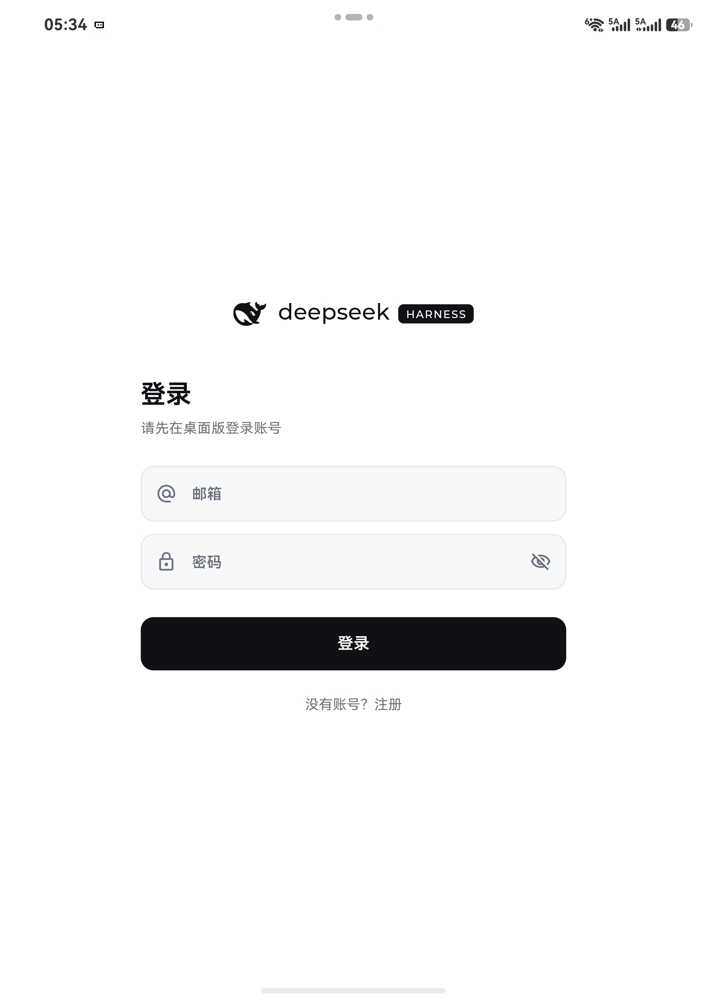
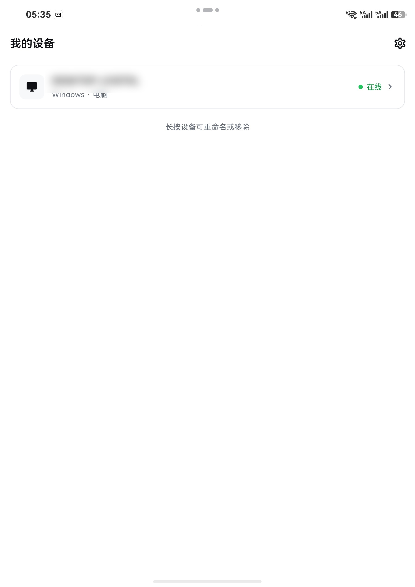
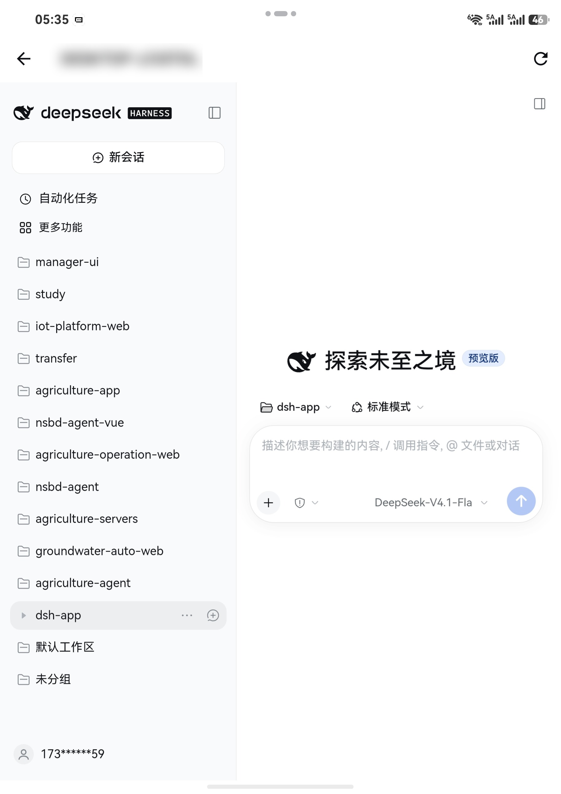
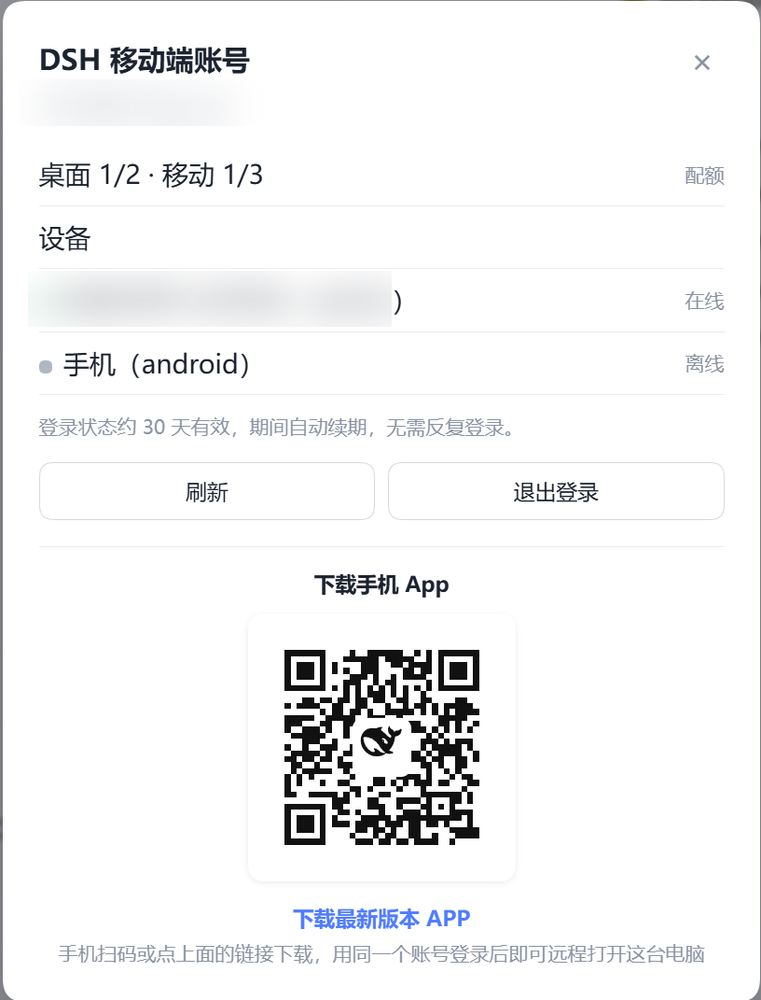

# Add dsh-mobile-tunnel (qiaohelenjoe/dsh-app — `plugin/`)

## What it is

A remote-control plugin pair for DeepSeek Harness:

- **Desktop side**: registers this computer as a device over an **outbound** WebSocket tunnel (`ws`), so no inbound port or port forwarding is needed. Also exposes a small account panel in the PC sidebar: login state, device quota, device list, and the latest Android App download QR code.
- **Mobile side**: an Android shell (Flutter, published separately) that lists your devices and opens the machine's DSH web UI inside a WebView; a host-side `/api/file` proxy and the narrow-screen adapters make the existing DSH web UI usable on a phone.

Backed by a small account service (email/password login, devices, tunnel tickets). The App download page and APK are hosted by the author; the source for the whole system is in the same repository.

## Install

```sh
dsh plugin --profile web add github:qiaohelenjoe/dsh-app#path:/plugin
```

Prebuilt `dist/` and `client/` are committed, so the GitHub install works without a build step.

- On the desktop profile (managed by Electron), install through the DSH settings page instead of `dsh plugin --profile desktop`.

## Screenshots

| Mobile | |
|---|---|
|  |  |

| Device page | Panel |
|---|---|
|  |  |

## Notes

- Category: `remote` — it is about reaching a Harness instance from another device.
- The plugin ships no runtime dependency beyond `ws`.
- README: https://github.com/qiaohelenjoe/dsh-app/tree/main/plugin
